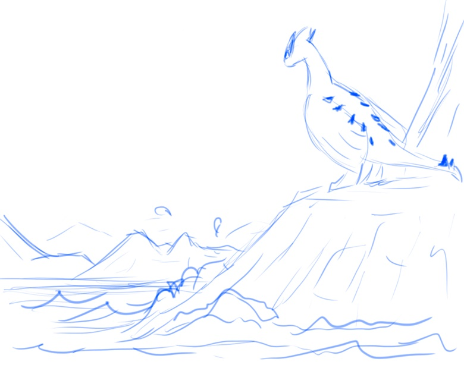

It occurred to me recently that the quality of my "sketches" has steadily improved to the point where they were basically not sketches anymore, but more along the lines of "fine lines".

<!--more-->

Unfortunately it is taking me more and more time to complete them, when they were all really supposed to be quick doodles. Some of them are taking me an hour or more! I will probably need to go back to a looser style for these sketches (such as the one at the top of this post) and I really hope no one minds.

I also hope that a looser style of sketch will still be able to get the point across. Hopefully this means more requests can be taken on Twitch in future too!
