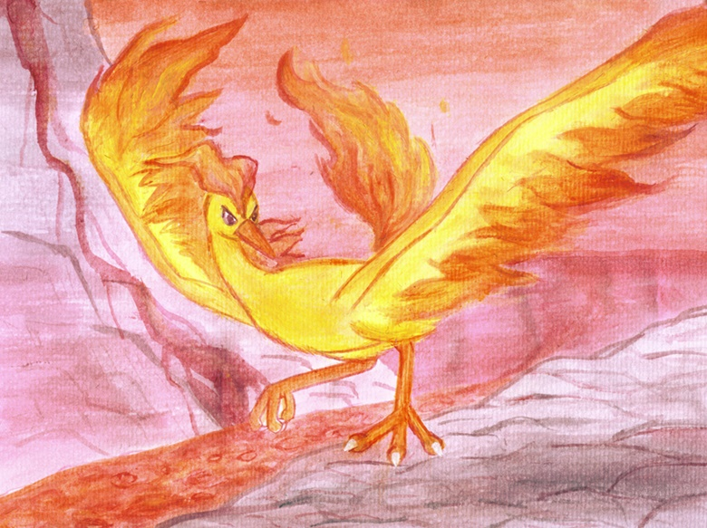

As I have previously mentioned to some of you, I have been slowly trying to transition to traditional art and my main goal is to replicate my digital style with paint, specifically watercolour and gouache. While this has been going OK so far, the main issue I have is time!

<!--more-->

Digital is a lot quicker and more portable, I don't have to spend lots of time mixing the right colours when there is a colour picker available. I am also very familiar with my digital style which means I am more efficient at colouring (in reality, I just use the fill tool to colour within the lines before I shade on top!)

Gouache has certainly made it much more challenging to mix colours! They dry very quickly and you need several mixes to get several tones of a specific colour. I am trying to stick to just three tones currently - a base colour, highlights and shading, but even so I am finding myself running out of space on my ceramic palette!\\
Watercolour has been easier and quicker than this. A little paint mix goes a long way. For lighter and darker shades you only need to layer a single colour on top of itself, but I can't seem to achieve the exact look I can get from gouache. I probably just need more practice to be fair, but once again I am restricted by time... especially during the warmer months. There is a lot of gardening and ornithology work to undertake.

Ahh, the curse of a full time worker strikes again! You may have noticed that my art productivity is down, this is mainly due to working on a painting very slowly (we're talking 1-2 hours per week!)\\
I hope to get as comfortable with painting as I am with digital some day. In the meantime my coloured pieces will be a little limited.
