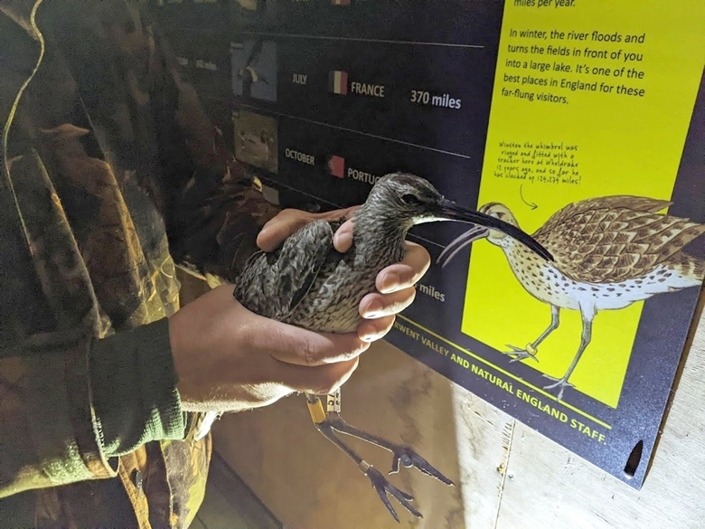
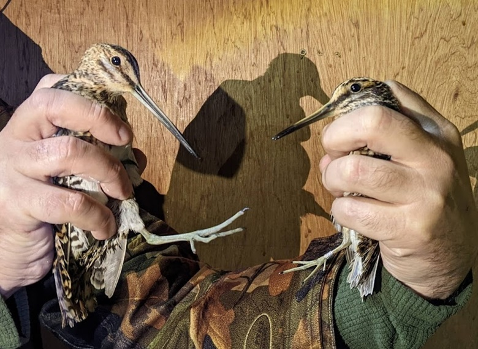
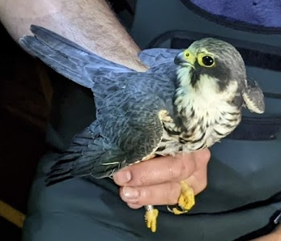
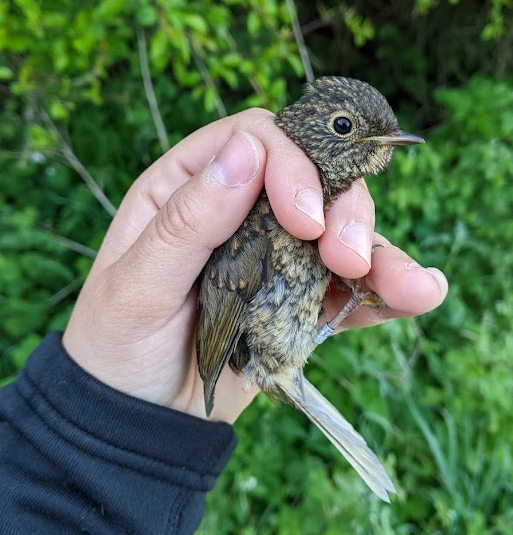
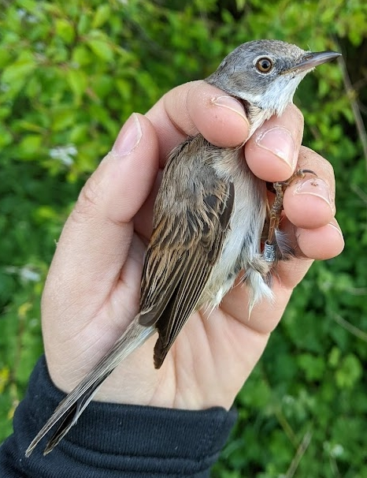
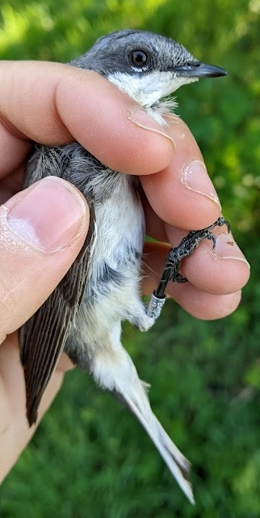

The group have had a very busy few weeks since I last posted. Plenty of passerines have been ringed and we were also lucky enough to join the group at Wheldrake for Whimbrel ringing!\\
Whimbrel are fascinating long distance migrants who stop over at the Lower Derwent Valley on the way to their Icelandic breeding grounds. A Whimbrel colour-ringing project has been ongoing at Wheldrake for over a decade, and while working on it last Monday our "by-catch" were Common Snipe, Jack Snipe and an adult Hobby.

<!--more-->

Common Snipe (left) breed in the UK and are joined by additional foreign visitors over winter. Jack Snipe (right) are entirely migratory like Whimbrel; we only catch them on passage.

Hobby is a summer migrant that follows its prey up from Africa. This bird was an adult female.

On the passerine front, the Old Railway Line had its first fledgling bird of the year in the form of a European Robin.

As Robins are resident birds, they begin to breed much earlier in the year than migratory species. Their first broods are now out and flying around (into our nets!). What a lovely surprise this was!\\
A couple of new species have also been caught, Common Whitethroat (top) and Lesser Whitethroat (bottom). These are male birds, though you can't sex a Lesser Whitethroat on plumage alone.

As birds settle into their breeding territories, ringing gets a little quiet. Most of the birds have already been caught so now we are waiting for the influx of fledglings which will hopefully be out in June.

**April 14th 2022**

Chiffchaff - 9\\
Blackcap - 12\\
Willow Warbler - 3\\
Blackbird - 3\\
Wren - 2\\
Robin - 2\\
Reed Bunting - 1\\
Yellowhammer - 1

Total = 33

**May 1st 2022**

Robin - 1\\
Blackcap - 6\\
Song Thrush - 1\\
Chiffchaff - 3\\
Whitethroat - 3\\
Wren - 4\\
Bullfinch - 2\\
Blackbird - 3\\
Willow Warbler - 1\\
Lesser Whitethroat - 1\\
Blue Tit - 1

Total = 26
