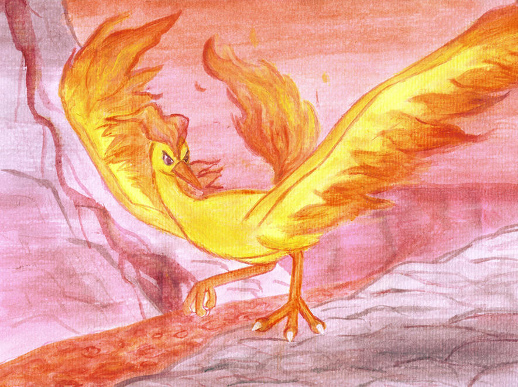
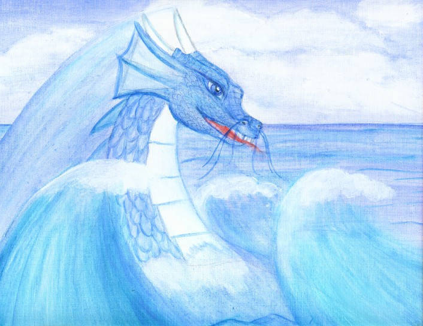
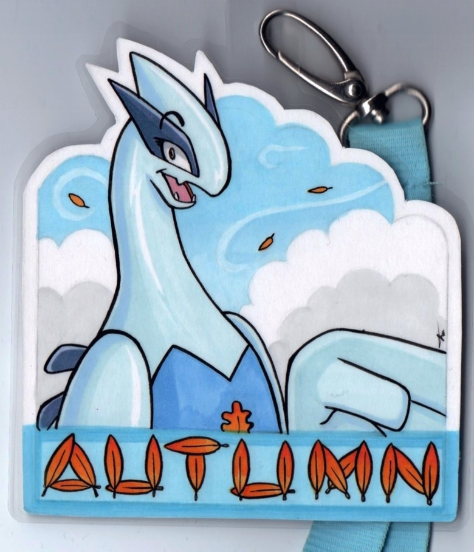
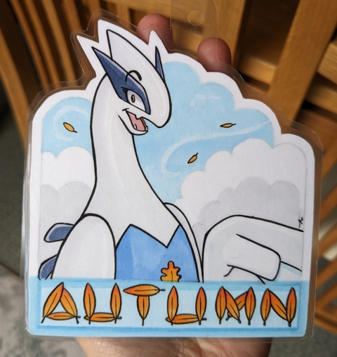
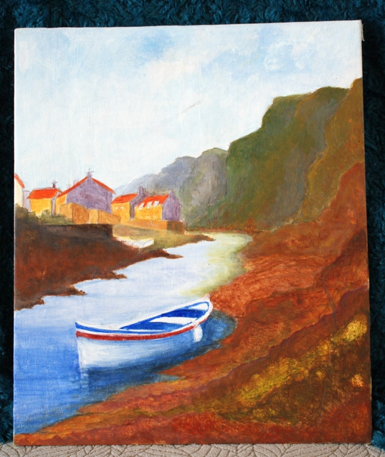

Hello my wonderful friends and supporters! Today I want to share a story with you about my experiences with acrylic painting, and why I chose not to complete the canvas painting that I started last week in time for selling at my art stall (which was on Sunday).

<!--more-->

Many years ago I used to use cheap acrylic paints without really knowing what I was doing. Here is an example of the very first one I did several years after leaving school.

And here is another example of a canvas painting I whipped up with no planning or references while I was away for a weekend with no access to the internet.

Due to my obvious lack of skill and experience, I went years thinking I could not paint. Looking at these today I realise there was a lot of potential... what a shame I didn't see it at the time.

I spent the next few years focusing entirely on digital art but deliberately avoiding digital painting or "lineless" as it was sometimes known. I stuck to what I was good at which was precise lines and smooth shading.\\
Eventually I got the hang of traditional art by replicating my digital style with alcohol-based markers and fineliners. Unfortunately after I'd "mastered" this medium, I found out that alcohol-based markers were not lightfast and therefore the colours would ultimately fade. I no longer felt comfortable using them for illustrations, especially not on commissions for paying customers!

A few things had to happen all at the same time for me to give painting another try. One of those was that I randomly made a digitally painted Lugia headshot and the feedback from people was more positive than I imagined.

Secondly, while looking for a marker alternative I discovered gouache - a type of paint that appeared as if it would suit my traditional style. I set about learning how to use them the "correct" way and was gifted a set of professional gouache paints in the colours of my choice.

Finally, I started furthering my art studies by actively learning the skills and theory I was so badly missing and I think this was a turning point for me! I began to apply what I was learning with the use of professional art supplies (paint, cotton paper and high quality brushes). I also joined my local art club and was encouraged by the other members who seemed to see the potential in my work.

"But wait, weren't we meant to be talking about acrylic painting and canvases here?"

Indeed we were, but there is no doubt that my journey into painting started with gouache. It was only on a random day at the art club when someone held a workshop that I realised my painting style also worked in acrylic paints. I'm not sure if I ever posted the completed photo of this workshop painting but here it is.

It's not exactly amazing work, but mostly I just enjoyed the process. The "feel" of the paint and the way I could blend it like a Photoshop brush or gouache paint was very exciting for me.

This was the gateway into proper canvas painting, or so I thought. Soon after painting this I was gifted some professional acrylic paints to match the colours I'd chosen for my gouache ones, but the truth is it wasn't for another two or so years that I would even try them out, and that was just last week on the canvas "work in progress" photo I shared. The reason for this? I was afraid. I had many ideas in mind and plenty of blank canvases staring at me, but I wanted the perfect concept... the perfect composition... and so I wasted all this time not painting in a medium that is obviously very enjoyable to me.

So enjoyable are professional acrylic paints that once I'd actually laid some onto canvas, I made the decision not to rush the painting for the sake of making a sale. I decided I wanted to savour the feeling of blending the paint and the enjoyment of watching the colours come to life.

Yes I know it has taken me a long time to get to the point and I apologise, but there is a lesson to be had from my experiences here and that is ultimately to enjoy making art because making art is enjoyable without requiring any other purpose.\\
I think I want to make more paintings that make me happy and not worry so much about what everyone else thinks. Of course it is nice to share what I've made with you all, but making art just to impress other people really shouldn't be the end goal, know what I mean?

Thanks for reading ;>
