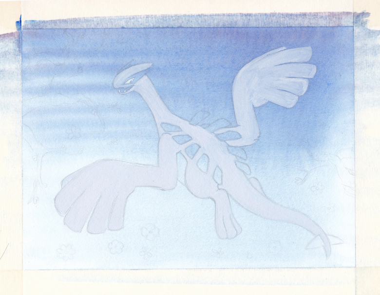

**"Strike While the Iron is Hot"**

<!--more-->

Do you know this phrase?

It's a common phrase in English. It means to take action quickly while conditions are favourable. Only recently I have realised that this is extremely applicable to art and creative ideas.

I think one of the reasons that I used to get plenty of art done "back in the day" is because I had no barriers and plenty of free time to just start making a piece of art as soon as the idea hit me. In other words I "struck while the iron was hot".

Today I feel the exact same drive and motivation to execute a creative idea while it is fresh, new and exciting! Unfortunately if I do not execute ideas quickly from start to finish, eventually they start to lose their appeal. Doubt starts to creep in, the opportunities are missed and the creations never actually come to frutition.

Life is busy. Life is also short. Creative ideas are always flowing through my head, too many to possibly execute even if I had all the time in the world! Sadly not even the best and most exciting ideas get given enough time to realise in my busy life schedule. Artwork that should only be taking me a day or two to finish is taking weeks, months and sometimes years to complete. A very large percentage of artwork that is started does not get completed at all.

The more I think about it, the more hopeless it seems. I could easily execute an idea using a fast format such as a sketch, pen drawing, quick watercolour painting etc. but the trouble is that if I feel like I've landed on a genius creative idea, then a quick execution will not do it justice. This is precisely why my Mega Lugia design never fully came to be, because I felt I didn't have enough time to create a character sheet of a high standard.

What is an artist to do when there are so many other things besides art that need doing? :(
