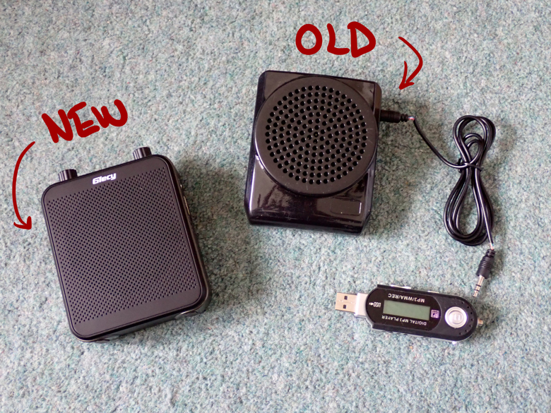

I want to say thank you to everyone who supports me as we managed to upgrade some of our really old equipment recently. The purchase was around £200 but it was easily paid for by your donations :>

<!--more-->

We use bird calls to lure certain species to our nets. For years we have been relying on mp3 players powered by AAA batteries. The batteries required charging before every session along with the speakers which only had a short battery life of around 2-5 hours. The cables we used to connect the mp3 players to the speakers were old and falling apart.

We have now purchased five all-in-one speakers with microSD card readers and long battery lives. This tech is much more reliable and easier to work with. No more AAA batteries, no more cables :> We tested them out over the weekend and successfully ringed 80 birds without the stress of the old speaker system.

Your support is very much appreciated at times like this!!

It has been a busy summer of ringing so our next big purchase will be another 300+ rings. Thank you!
