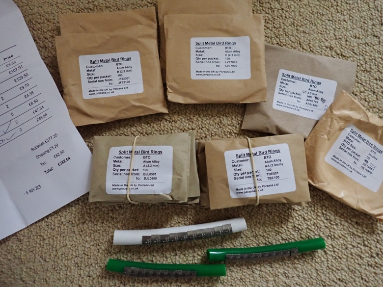

I have had my provisional "C" permit for bird ringing since 2021. This Ko‑fi page has fully supported my journey as a C-ringer. I would like to become a fully independent ringer with an "A" permit this year. My trainer asks that I do this, but I am struggling with time to be honest. I was meant to do this last year but certain commitments got in my way.

<!--more-->

Despite that, at the end of last year I purchased a huge batch of new rings using the saved funds from your membership and donations ^v^ thank you everyone for directly supporting this work, it is very important to me!\\
As you can see the price of rings is getting extremely expensive. I bought a large number of them to secure the price for several years to come.

The total number of birds ringed by my group in 2025 was 418. I expect that 2026 will be quite similar. This is a fairly small number of birds but still very important work to us. Our birds are still being re-captured after several years. Some of our longest surviving residents are Long-tailed Tits (Aegithalos caudatus) with birds from 2021 still being found alive and well!
