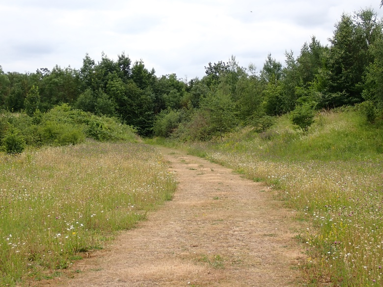

Hi everyone. Summer is usually a time when things go quiet here, but this year things are especially quiet! Since getting my new job, I have been travelling to the office at the other side of the country every month, but I've also been travelling for family matters in between that. So there hasn't really been much downtime.\\
When I do get a rare weekend at home, there are so many jobs to catch up on that I don't get time to rest.

<!--more-->

"Burnout" is a word that gets thrown around a lot but it definitely describes how I am feeling this year.

I need to free up my life a little bit. Right now, the only time I ever get for art is when I am on my boat, completely shut off from the world.\\
On the boat there are no fish tanks to look after, no laundry to do, no chores to catch up on, no commitments at all really. At home is a different matter - there are currently 5 fish tanks (too many) and a dozen or so houseplants, a garden that needs constant watering in the drought, housework, meal planning etc.

I wish for a simpler life, but I've filled my life with things that create work. I hope this can be reduced in future. None of these things are compatible with travelling a lot.

When my head is clear, when I free up some time, when my home becomes a sanctuary again like the boat is now, then maybe I sit down to express myself through art :>\\
Maybe also I will follow through on my rebrand of this page.
